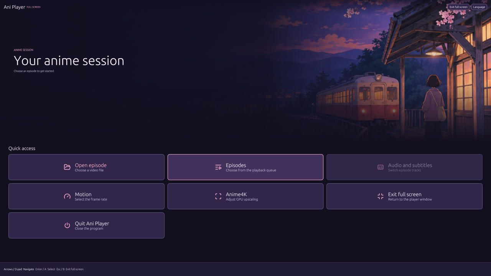

# Ani Player

Ani Player is a free desktop video player for anime. Its Rust interface organizes local episodes into folders and seasons. mpv handles playback.



## Features

- **Episode library.** Add local files or M3U playlists, organize episodes in nested folders, and pick up your saved queue after restarting. Hover over a local episode to preview short clips.
- **Anime4K.** Choose a preset in **Motion → Anime4K**. The shaders run in mpv, with output sized to the video area.
- **RIFE interpolation.** Select a frame-rate target in **Motion**. This requires an mpv build with VapourSynth, the RIFE plug-in and model, and a compatible GPU runtime.
- **Playback controls.** Switch audio tracks, load external subtitles, and jump to chapters. FFmpeg handles MKV export and thumbnail generation. HLS sharing also uses Python.
- **Seven interface languages.** Choose one under **Tools → Configuration → Language** or from the full-screen menu.

## Download and run

Use the package for your platform from [Releases](https://github.com/Apolinario-coder/aniplayer/releases). The packages use system-installed media tools. Put mpv and FFmpeg on your `PATH` before launching, then choose **Open episode** or drop a file into the player.

| Platform | Package | Playback |
| --- | --- | --- |
| Windows x64 | Extract the ZIP and open `Ani Player.exe`. | Video plays inside Ani Player. |
| Linux x86-64 | Run `chmod +x Ani-Player-*.AppImage` and open the AppImage. Use a distribution with glibc 2.35 or newer. | Video opens in an mpv window. |
| macOS 12 or later, Apple Silicon or Intel | Open the PKG and launch Ani Player from Applications. The PKG is unsigned. | Video opens in an mpv window. |

Linux and macOS use separate playback windows. Embedded playback, the in-video settings panel, and XInput controller navigation are Windows features. GPU RIFE on Linux and macOS requires a compatible local setup and has not been verified on those platforms.

For online URLs, install yt-dlp. For HLS, install Python 3. The macOS app searches the standard Homebrew paths. You can point Ani Player directly to its tools with `ANI_MPV`, `ANI_FFMPEG`, and `ANI_PYTHON`.

For Ubuntu or Debian, install the local playback tools with `sudo apt install mpv ffmpeg python3 curl`. On macOS with Homebrew, use `brew install mpv ffmpeg yt-dlp`.

Ani Player checks GitHub at startup for a newer stable release. **Download update** opens the release in your browser, where you can choose your platform's package.

## Build from source

Install stable Rust and the system development libraries for your platform. Linux needs OpenGL, X11 or Wayland, and xkbcommon development libraries. Windows builds use `rc.exe` with MSVC or `windres` with GNU. macOS builds use Xcode command-line tools.

```sh
cargo build --release --locked
cargo test --release --locked
```

The executable is in `target/release`. The [package workflow](.github/workflows/packages.yml) contains the commands for creating the AppImage and universal macOS installer. For a local Windows installer with runtime files you supply, run `installer/Build-Installer.ps1 -RuntimeRoot <path>` in PowerShell.

When [reporting a bug](https://github.com/Apolinario-coder/aniplayer/issues), include the Ani Player and mpv versions, your operating system, and a short way to reproduce it.

## Credits

- [mpv](https://mpv.io/) handles video and audio playback.
- [FFmpeg](https://ffmpeg.org/) supplies export, previews, and HLS encoding.
- [Anime4K](https://github.com/bloc97/Anime4K) supplies the [vendored shaders](assets/anime4k/LICENSE).
- [VapourSynth](https://www.vapoursynth.com/) hosts the optional RIFE video filter.
- [egui and eframe](https://github.com/emilk/egui) supply the interface and native window.
- [Noto Sans CJK](https://github.com/notofonts/noto-cjk) supplies the bundled Chinese and Japanese font subsets. See the [font license](assets/i18n/Noto-OFL.txt).
